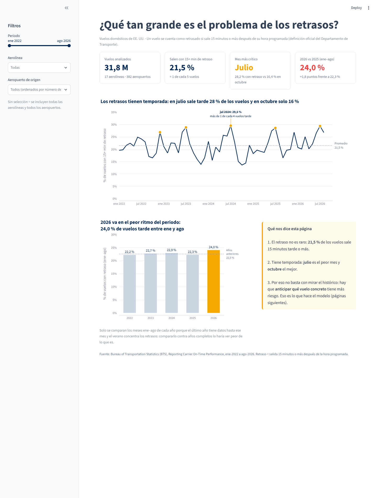

# Missed Flight Risk — US Domestic Flights

Predicting, **before departure**, the probability that a US domestic commercial flight leaves 15 minutes or more after its scheduled time (`DepDel15 = 1`).

Universidad EAFIT — Proyecto Integrador 1. Methodology: ASUM-DM.

**Team:** Jerónimo Acosta Acevedo, Santiago Gomez, Alejandro Quintero Moreno, Victor Daniel Delgado.

---

## 1. Data Prerequisite

Before starting the project's analysis, the raw BTS data (*Reporting Carrier On-Time Performance*, 2022-01 to 2026-08, about 32.4 M flights) was converted from the monthly `.zip` files to `.csv` and then to Parquet, one file per month, partitioned by year and month and restricted to the 35 columns used in the project. This is the **bronze layer** of the Medallion architecture:

```
data/bronze/parquet/year=YYYY/month=MM/flights.parquet
```

The conversion script is `src/utils/csv_to_parquet.py`. The raw `.zip` files remain the original copy of the data. The data itself is not versioned in this repository.

**Data Source:**
* Bureau of Transportation Statistics. *Reporting carrier on-time performance (1987–present)* [Data set]. U.S. Department of Transportation. [Link](https://www.transtats.bts.gov/DL_SelectFields.asp?gnoyr_VQ=FGJ)
* Project Drive. [Link](https://drive.google.com/file/d/1cE-UlXny8HNnc7SW8mTAhpKbvGNIjZQc/view?usp=sharing)

---

## 2. Project Structure

```
data/
├── bronze/parquet/      # converted data (prerequisite above)
├── silver/flights/      # output of the EDA / leakage notebook
├── agg_*.parquet        # aggregated tables for the dashboard (DuckDB)
├── modelo/              # model test results (copy of outputs/outputs_modeling)
└── predicciones/        # flight-by-flight predictions for August 2026 + meta.json

outputs_eda/             # figures and leakage audit from EDA

src/                     # source code and modeling
├── flight_delay_eda_leakage.ipynb
├── flight_delay_modeling.ipynb
└── utils/csv_to_parquet.py

dashboard/               # visualization component
├── app.py               # entry point: config, sidebar filters, and page menu
├── paginas/             # one page per file (1_resumen.py ... 5_limites.py)
├── utils/
│   ├── estilo.py        # course palette and formatting (#002855 blue, #F5A800 gold, grays)
│   └── datos.py         # ALL data reading and filtering (change here to read from API)
├── preparar_datos.py       # silver layer → aggregated tables in data/ (DuckDB)
├── generar_predicciones.py # runs modeling notebook and scores a month (with SHAP)
└── .streamlit/config.toml  # visual theme

requirements.txt         # unified dependencies for EDA, modeling, and dashboard
```

---

## 3. How to Run

Requirements: Python 3.10+, `duckdb`, `pandas`, `numpy`, `matplotlib`, `seaborn`, `scikit-learn`, `lightgbm`, `xgboost`, `streamlit`, `plotly`.

First, install all dependencies from the root of the repository:

```bash
pip install -r requirements.txt
```

### 3.1 Data Preparation (EDA & Leakage Audit)
Open `src/flight_delay_eda_leakage.ipynb` and run it top to bottom. It reads the bronze layer, audits the columns for data leakage, and writes the cleaned silver layer.

### 3.2 Dashboard
The interactive dashboard (Componente de Visualización de Datos SI7007) is built with Streamlit + Plotly following the course rules: *Context + Data + Contrast = Message*.

To launch it from the **root of the repository**:

```bash
streamlit run dashboard/app.py
```
It will open automatically in your browser at `http://localhost:8501`. Press `Ctrl + C` in the terminal to stop it.

> **Note:** The data required for the dashboard is already included in `data/` (~21 MB), so **it is not necessary to have the silver layer downloaded** to view it.

---

## 4. Dashboard Details

 *(Check the `dashboard/capturas/` folder for more screenshots)*

### The 5 Pages (Narrative Arc: Context → Conflict → Resolution)

| Page | Question Answered | Interactivity |
| --- | --- | --- |
| **1. Resumen del problema** | ¿Qué tan grande es el problema y cómo cambia en el tiempo? | Filtros de periodo, aerolínea y aeropuerto |
| **2. Dónde está el riesgo** | ¿En qué horas, días, aerolíneas y aeropuertos se concentra? | Clic en una aerolínea filtra los aeropuertos (drill-down) |
| **3. ¿Podemos confiar en el modelo?** | ¿Acierta más que el azar? ¿Por qué LightGBM? ¿Las probabilidades son confiables? | Selector de cuántos vuelos revisa el equipo |
| **4. Priorización del día** | ¿Qué vuelos vigilar hoy y por qué? (caso aplicado) | Día, número de vuelos, clic en un vuelo para ver su explicación SHAP |
| **5. Dónde no confiar tanto** | ¿En qué grupos acierta menos o se desvía el modelo? | Ver por aerolínea, aeropuerto, franja o temporada |

### Where Dashboard Data Comes From

1. **Aggregated Tables** (`data/agg_*.parquet`): `preparar_datos.py` reads the silver layer (31.8M flights) and saves flight and delay counts (not rates, as filtering requires `sum(delayed)/sum(flights)`).
   ```bash
   # requires downloaded silver layer
   python dashboard/preparar_datos.py
   ```
2. **Model Results** (`data/modelo/`): A copy of the results generated by the modeling notebook.
3. **Flight Predictions** (`data/predicciones/`): `generar_predicciones.py` runs the modeling cells, scores all flights for August 2026, and calculates the top 3 risk-increasing SHAP variables per flight (takes ~10 mins).
   ```bash
   python dashboard/generar_predicciones.py
   ```

### Pending / To-Do
- **Read data from AWS API** (team's medallion layers) instead of local files. Only `dashboard/utils/datos.py` needs updating.
- Publish on Streamlit Community Cloud.

### Note on Rigor
Pages 3 and 4 address a potential data leak: flights with negative or <20 min turnaround times (2.5% of flights) represent same-day aircraft swaps and concentrate almost all of the top 1% highest risk. Page 4 hides these by default.