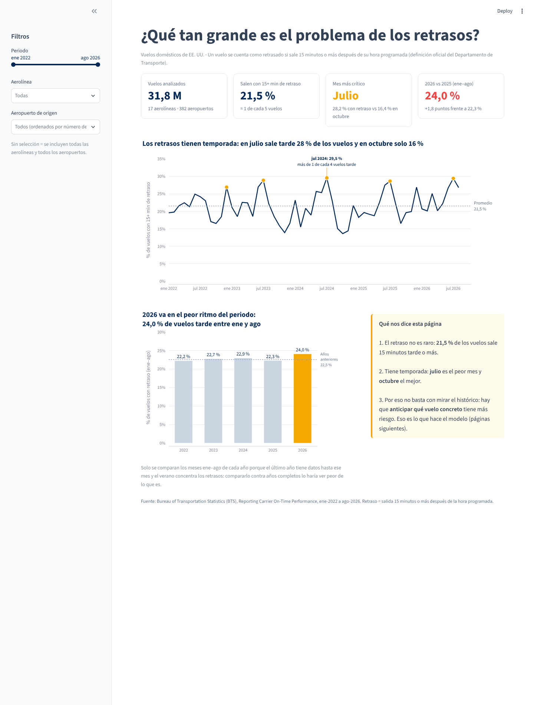

# Dashboard — Riesgo de retraso en vuelos comerciales de EE. UU.

Proyecto Integrador 1 · Maestría en Ciencia de Datos y Analítica · EAFIT · Grupo 12.
Componente de **Visualización de Datos (SI7007)**, hecho en [Streamlit](https://streamlit.io) + Plotly
siguiendo las reglas del curso: Contexto + Datos + Contraste = Mensaje.



## Cómo ejecutarlo

Necesitas Python 3.10 o superior. Desde la **raíz del repositorio**:

```bash
pip install -r dashboard/requirements.txt
streamlit run dashboard/app.py
```

Se abre solo en el navegador en `http://localhost:8501`. Para detenerlo: `Ctrl + C` en la terminal.

Los datos que necesita ya vienen dentro de `dashboard/data/` (unos 21 MB), así que **no hace falta
tener la capa plata descargada** para abrirlo.

## Las 5 páginas (arco narrativo: contexto → conflicto → resolución)

| Página | Pregunta que responde | Interactividad |
| --- | --- | --- |
| 1. Resumen del problema | ¿Qué tan grande es el problema y cómo cambia en el tiempo? | Filtros de periodo, aerolínea y aeropuerto |
| 2. Dónde está el riesgo | ¿En qué horas, días, aerolíneas y aeropuertos se concentra? | Clic en una aerolínea filtra los aeropuertos (drill-down) |
| 3. ¿Podemos confiar en el modelo? | ¿Acierta más que el azar? ¿Por qué LightGBM? ¿Las probabilidades son confiables? | Selector de cuántos vuelos revisa el equipo |
| 4. Priorización del día | ¿Qué vuelos vigilar hoy y por qué? (caso aplicado) | Día, número de vuelos, clic en un vuelo para ver su explicación SHAP |
| 5. Dónde no confiar tanto | ¿En qué grupos acierta menos o se desvía el modelo? | Ver por aerolínea, aeropuerto, franja o temporada |

Capturas de cada página en la carpeta `capturas/`.

## Estructura

```
dashboard/
├── app.py                    # entrada: configuración, filtros de la barra lateral y menú de páginas
├── paginas/                  # una página por archivo (1_resumen.py ... 5_limites.py)
├── utils/
│   ├── estilo.py             # paleta y formato del curso (#002855 azul, #F5A800 dorado, grises)
│   └── datos.py              # TODA la lectura de datos y los filtros (único punto a cambiar para leer de la API)
├── data/
│   ├── agg_mes.parquet       # vuelos y retrasados por mes × aerolínea × aeropuerto
│   ├── agg_hora.parquet      # ... además por hora de salida
│   ├── agg_dia_hora.parquet  # ... por día de la semana × hora (mapa de calor)
│   ├── modelo/               # resultados de la prueba del modelo (copia de outputs/outputs_modeling)
│   └── predicciones/         # predicción vuelo por vuelo de agosto 2026 + meta.json
├── preparar_datos.py         # capa plata → tablas agregadas de data/ (DuckDB)
├── generar_predicciones.py   # corre el notebook de modelado y puntúa un mes (con SHAP)
├── requirements.txt
└── .streamlit/config.toml    # tema visual
```

## De dónde salen los datos

1. **Tablas agregadas** (`data/agg_*.parquet`): `preparar_datos.py` lee la capa plata
   (`data/silver/flights`, 31,8 M de vuelos) y guarda conteos de vuelos y retrasados. Se guardan conteos
   y no tasas, porque al filtrar la tasa correcta es `sum(retrasados) / sum(vuelos)`.
   ```bash
   python dashboard/preparar_datos.py        # requiere la capa plata descargada
   ```
2. **Resultados del modelo** (`data/modelo/`): copia de `outputs/outputs_modeling/` que genera
   `src/flight_delay_modeling.ipynb`.
3. **Predicciones por vuelo** (`data/predicciones/`): `generar_predicciones.py` ejecuta las celdas del
   notebook de modelado (mismas variables y LightGBM), puntúa todos los vuelos de agosto de 2026 y calcula
   las 3 variables que más suben el riesgo de cada vuelo (SHAP). Tarda unos 10 minutos.
   ```bash
   pip install lightgbm xgboost scikit-learn matplotlib
   python dashboard/generar_predicciones.py
   ```

## Pendiente

- **Leer los datos desde la API de AWS** (capas medallion del equipo) en lugar de `dashboard/data/`.
  Solo hay que cambiar las funciones `cargar_*` de `utils/datos.py`; las páginas no cambian.
- Publicarlo en Streamlit Community Cloud (archivo principal: `dashboard/app.py`).

## Nota de rigor

En la página 3 y 4 se explica una posible fuga: vuelos con tiempo entre vuelos del avión negativo o menor a
20 minutos (2,5 % de los vuelos) son cambios de avión hechos durante el día y concentran casi todo el 1 % de
mayor riesgo. La página 4 los oculta por defecto.

## Reutilizarlo con otros datos

- `utils/estilo.py` sirve tal cual para cualquier dashboard con el estilo del curso (`layout_base`, `kpi`, paleta).
- `app.py` muestra el patrón de filtros globales en la barra lateral + `st.navigation` con varias páginas.
- Para otros datos: cambia las funciones de `utils/datos.py` y adapta las páginas.
